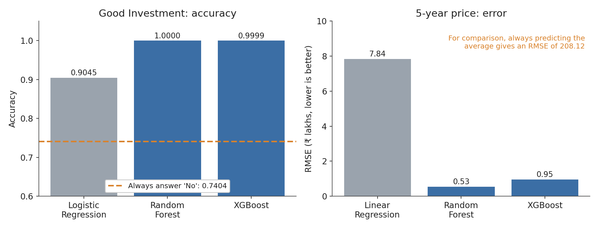
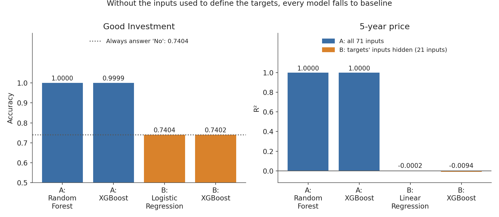

# Real Estate Investment Advisor

A machine learning project that helps a user judge a property before buying it. Given a property's details, it answers two questions:

1. **Is this a good investment?** (classification)
2. **What will it be worth in 5 years?** (regression)

The models are served through a Streamlit web app, and every training run is tracked with MLflow.

> **Important:** the dataset appears to be synthetic, and both prediction targets are defined by rules written for this project (see [Targets](#targets)). The high scores below show that the models learned those rules, not real-market behavior. The Option B experiment demonstrates this. This project is for learning and is not financial advice.

## What's inside

- **Data preprocessing:** fixing a broken price-per-sqft column, repairing impossible floor data, splitting amenities, encoding, feature engineering, stratified train/test split and scaling
- **Exploratory analysis:** 20 questions answered with charts (`notebooks/eda.ipynb`)
- **Models:** Logistic/Linear Regression, Random Forest and XGBoost for both tasks
- **Experiment tracking:** all six models logged to MLflow
- **Streamlit app:** a prediction form, market insights (filters, heatmap, trends) and feature-importance charts

## Dataset

`india_housing_prices.csv`: 250,000 property listings, 23 columns, no missing values or duplicates.

The raw file is not stored in this repository because of its size. Download it from the link in the project brief, create a folder called `data`, and put the file inside as `data/india_housing_prices.csv`.

## Targets

Neither target exists in the raw data, so both are defined in `step1.py`:

- **Future price (5 years)** = current price x (1 + growth)^5, where growth is 5% plus up to 5% more depending on a neighborhood infrastructure score built from schools, hospitals and public transport.
- **Good investment** = priced at or below its city's median price per sqft **and** infrastructure score at or above the median (about 26% of properties).

## Results

Evaluated on 50,000 held-out properties.

| Task | Model | Result |
|---|---|---|
| Good investment | Logistic Regression | Accuracy 0.9045, F1 0.8119 |
| Good investment | Random Forest | Accuracy 1.0000, F1 1.0000 |
| Good investment | XGBoost | Accuracy 0.9999, F1 0.9999 |
| 5-year price | Linear Regression | RMSE 7.84 lakhs, R2 0.9986 |
| 5-year price | Random Forest | RMSE 0.53 lakhs, R2 1.0000 |
| 5-year price | XGBoost | RMSE 0.95 lakhs, R2 1.0000 |

Always answering "No" scores 0.7404 accuracy; always predicting the average price gives an RMSE of 208.12 lakhs.



### Option B experiment: hiding the targets' inputs

When every input used to build the targets is removed (price, size, price per sqft, schools, hospitals, transport, city), all models fall to baseline:

| Task | Model | Result |
|---|---|---|
| Good investment | Logistic Regression | Accuracy 0.7404, ROC-AUC 0.5001 |
| Good investment | XGBoost | Accuracy 0.7402, ROC-AUC 0.4991 |
| 5-year price | Linear Regression | R2 -0.0002 |
| 5-year price | XGBoost | R2 -0.0094 |

The remaining property features carry no predictive signal in this dataset, which matches the exploratory analysis.



## Documentation

The full write-up is in [`docs/Project_Documentation.pdf`](docs/Project_Documentation.pdf). It covers the preprocessing decisions, the answers to all 20 EDA questions, the model results, the Option B experiment, the app, and the limitations.

## Project structure

```
app/
  app.py                    Streamlit app (3 tabs)
  invest_predictor.py       turns form answers into the 71 model inputs
src/
  step1.py                  preprocessing, features, targets, split, scaling
  step3_classification.py   trains and compares classifiers
  step3_regression.py       trains and compares regressors
  step4_mlflow.py           trains all six models with MLflow tracking
  step5_make_artifacts.py   saves city medians and city-state lookups
  step5_test_predictor.py   checks the app's predictor against real rows
  step6_option_b.py         Option B experiment
  make_requirements.py      writes requirements.txt from installed versions
  compress_models.py        shrinks the saved model files
notebooks/
  eda.ipynb                 the 20 EDA questions
data/                       put india_housing_prices.csv here (other CSVs are generated)
models/                     trained models, scaler and lookup files
docs/                       Project_Documentation.pdf and images/ (figures)
requirements.txt
README.md
```

## How to run

Python 3.10 or newer is recommended.

```bash
# 1. Install dependencies
python -m pip install -r requirements.txt

# 2. Put india_housing_prices.csv in the data/ folder, then build the data
python src/step1.py

# 3. Train the models
python src/step3_classification.py
python src/step3_regression.py

# 4. (Optional) track all runs in MLflow, then view them
python src/step4_mlflow.py
python -m mlflow ui --backend-store-uri sqlite:///mlflow.db

# 5. Prepare and test the app's predictor
python src/step5_make_artifacts.py
python src/step5_test_predictor.py

# 6. Launch the app
python -m streamlit run app/app.py
```

Run every command from the project root (the folder that contains `app/`, `data/` and `models/`).

The trained models and lookup files are included in `models/`, so you can go straight to step 6 to try the Advisor tab. The Market insights tab and the predictor test also need `data/cleaned_housing.csv`, which `step1.py` creates from the raw dataset.

## Limitations

- The data looks randomly generated: price, size, location and amenities are independent of one another.
- The growth formula and the good-investment rule are assumptions, not observed outcomes.
- Near-perfect scores reflect how well the models reproduce those rules.
- For 46.5% of listings the floor number exceeded the building's total floors; these were repaired and flagged rather than dropped.

## Future work

Use real listings with sale prices over time, replace the assumed growth formula with observed appreciation, and define a good investment from real outcomes such as realized returns or rental yield.

## Author

**Saish Bhalchandra Bore**
[LinkedIn](https://www.linkedin.com/in/saish-bore-59068926b)